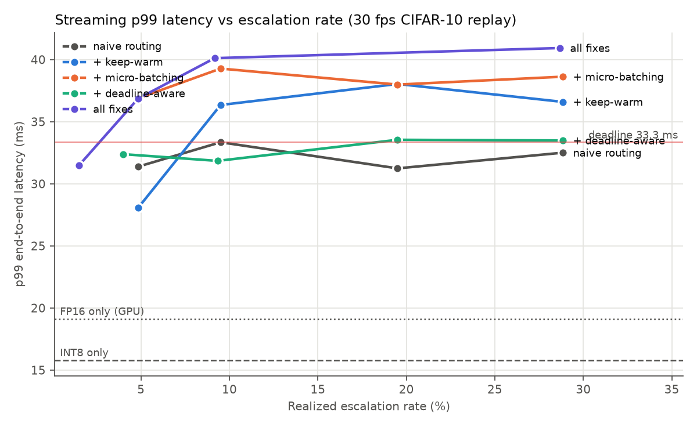
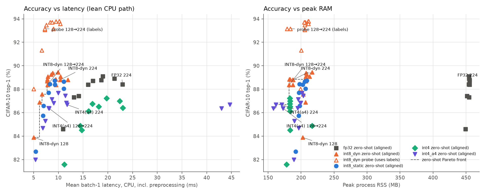

# Does coverage-based calibration selection help static INT8 PTQ of a VLM?

**Hypothesis.** For static INT8 post-training quantization, choosing calibration images to *cover*
the embedding space (greedy k-center) gives a better INT8 model than random selection, especially
at small calibration budgets N.

**Answer on this setup: no.** K-center was never better than random beyond seed noise, and at
N=512 it was clearly worse (84.26% vs 85.68% mean random; random seeds span 85.58–85.81%).
Routing low-confidence INT8 outputs to FP16 did work: escalating 20% of inputs recovers
88.0% accuracy (FP32 is 88.3%) at ~14.8 ms mean latency.

## Setup

| | |
|---|---|
| Model | OpenAI CLIP ViT-B/32 (`openai/clip-vit-base-patch32`), zero-shot |
| Task | CIFAR-10, frozen prompt `"a photo of a {}."`, full 10,000-image test set |
| Hardware | Apple M1 Pro (10-core CPU), 16 GB, macOS |
| INT8 | ONNX Runtime 1.31 static QDQ on CPU: per-channel symmetric INT8 weights, asymmetric UINT8 activations, MinMax calibration; MatMul/Gemm/Conv quantized, LayerNorm/Softmax/GELU kept FP32 |
| What's quantized | Image encoder only. Text embeddings and the cosine-similarity head stay FP32 |
| Baselines | FP32 on ORT CPU (the matched backend for INT8); FP32 and FP16 on PyTorch MPS. FP16 on CPU was not measured (no FP16 CPU path in this stack) |

**Calibration.** A fixed pool of 5,000 images is drawn (seed 0) from the CIFAR-10 *train* split;
the test split is used only for evaluation. Selection methods:

- **Random:** seeded permutation; seeds 0, 1, 2 to show seed variance.
- **K-center:** greedy farthest-point selection on L2-normalized FP32 CLIP image embeddings.
  It starts deterministically from the point nearest the pool mean.

Each method yields one ordering, and the N=32/128/512 sets are its prefixes. That gives 12 INT8
models: 4 orderings × 3 sizes.

**Measurement.**
- **Latency:** batch size 1, on a fixed set of 300 test images, with 30 untimed warm-up runs.
  Each image is timed in 3 passes and its per-image latency is the median. MPS runs are
  synchronized before stopping the clock.
- **Isolation:** every model is benchmarked in its own process.
- **Memory:** process peak RSS (`ru_maxrss`). For MPS this includes torch and does not fully
  capture GPU allocations.

## Results


| Variant | Backend | Top-1 % | Agree w/ FP32 % | Emb. cosine | p50 ms | p99 ms | Peak RSS MB | File MB |
|---|---|---|---|---|---|---|---|---|
| FP32 | ORT CPU | 88.30 | 100.00 | 1.000 | 30.9 | 31.4 | 811 | 335 |
| FP32 | PyTorch MPS | 88.30 | 100.00 | 1.000 | 10.0 | 10.7 | 773 | – |
| FP16 | PyTorch MPS | 88.30 | 99.92 | 1.000 | 9.0 | 9.7 | 1030 | – |
| INT8 k-center N=32 | ORT CPU | 85.73 | 86.95 | 0.818 | 13.1 | 13.5 | 634 | 85 |
| INT8 k-center N=128 | ORT CPU | 85.56 | 86.51 | 0.813 | 13.1 | 13.5 | 630 | 85 |
| INT8 k-center N=512 | ORT CPU | 84.26 | 85.30 | 0.812 | 13.0 | 13.3 | 646 | 85 |
| INT8 random N=32 (3 seeds) | ORT CPU | 85.85 (85.75–86.05) | 86.68 | 0.816 | 13.1 | 13.4 | ~650 | 85 |
| INT8 random N=128 (3 seeds) | ORT CPU | 85.81 (85.47–86.08) | 86.62 | 0.816 | 13.0 | 13.3 | ~640 | 85 |
| INT8 random N=512 (3 seeds) | ORT CPU | 85.68 (85.58–85.81) | 86.35 | 0.815 | 13.1 | 13.5 | ~640 | 85 |

Per-seed rows and raw numbers are in [results/results.md](results/results.md) and
[results/results.csv](results/results.csv).

**Reading it.**
- **Same-backend speed:** on ORT CPU, INT8 is 2.4× faster than FP32, has a 4× smaller file and
  uses ~170 MB less peak RSS. It costs about 2.5 points of top-1 accuracy.
- **Calibration size:** N barely matters for random selection (all means within 0.2 pt).
- **K-center fails at N=512:** k-center achieves its objective (coverage radius 0.54 vs ~0.65
  for random) but quantizes worse. One plausible explanation is that farthest-point sampling
  deliberately picks outlier images. With MinMax calibration, outliers widen activation ranges,
  which coarsens the quantization step for typical inputs. K-center also skews by class: 8 of
  10 classes at N=32, airplane- and truck-heavy at every N.
- **Practical takeaway:** for MinMax PTQ, coverage of the embedding space is the wrong target;
  range-representative (typical) samples matter more. Untested follow-ups: k-center combined with
  percentile or entropy calibration, or class-balanced and density-weighted selection.

## X-factor: confidence routing

Routing runs INT8 first. If the INT8 top-1/top-2 softmax margin is below a threshold, the image is
re-run at higher precision. The INT8 model is fixed in advance (k-center N=512), not chosen by
test accuracy.


| Escalated | Top-1 % → FP16 (MPS) | Mean ms | p99 ms | Top-1 % → FP32 (ORT CPU) | Mean ms |
|---|---|---|---|---|---|
| 0% | 84.26 | 13.0 | 13.3 | 84.26 | 13.0 |
| 10% | 86.50 | 14.0 | 22.7 | 86.51 | 16.2 |
| 20% | 88.00 | 14.8 | 22.7 | 88.03 | 19.0 |
| 30% | 88.61 | 15.9 | 22.7 | 88.63 | 22.8 |
| 100% | 88.30 | 22.1 | 22.8 | 88.30 | 43.9 |

- **AUROC for detecting INT8 ≠ FP32 top-1** (1,470 of 10,000 test images disagree): the margin
  score reaches **0.879**. Distance to the nearest calibration embedding reaches only 0.604, a
  weak signal.
- **Latency method:** routed latencies are composed from measured per-image batch-1 latencies of
  each model on the same images.
- **End-to-end check:** a real routed run at the 10% threshold (`python -m ptq.demo --bench`,
  [results/routing_e2e.json](results/routing_e2e.json)) measured 14.9 ms mean / 33.9 ms p99,
  against 14.0 / 22.7 composed.
  - The gap is likely MPS wake-up cost when GPU calls are sparse.
  - The composed p99 is therefore optimistic.
- **Same-device caveat:** INT8 runs on the CPU and FP16 on the GPU, so the FP16 route is not a
  same-device comparison. The FP32 ORT CPU route is. On this laptop, pure FP16 on MPS (9.0 ms,
  88.3%) dominates every CPU option. INT8/routing is the relevant choice only for CPU-only
  deployment.
- **Escalation above 100%-FP16 accuracy:** escalating 30–40% scores slightly higher than pure
  FP32/FP16 (88.6% vs 88.3%). This is within noise and should not be read as a real gain.

## Run it

```bash
python3 -m venv .venv && .venv/bin/pip install -r requirements.txt
.venv/bin/python -m ptq.run_all            # ~35 min on M1 Pro; every stage caches to artifacts/
.venv/bin/python -m ptq.run_all --report   # regenerate tables/plots from cache (seconds)
.venv/bin/python -m ptq.demo --cifar-test 0 1 2 5      # router demo on test images
.venv/bin/python -m ptq.demo path/to/photo.jpg          # or on your own image
.venv/bin/python -m ptq.demo --bench                    # real end-to-end routed timing
```

CIFAR-10 is loaded from the Hugging Face parquet mirror `uoft-cs/cifar10`, which uses the same
images, order and labels as the original release.

## Code

| File | Role |
|---|---|
| `ptq/common.py` | seeds, CLIP loading, frozen prompt, text embeddings, CIFAR-10 |
| `ptq/data_cache.py` | train-only calibration pool; cached resized uint8 images |
| `ptq/select.py` | random and k-center selection; coverage stats |
| `ptq/quantize.py` | ONNX export and ORT static INT8 |
| `ptq/build.py` | builds the 12 INT8 models |
| `ptq/evaluate.py` / `ptq/bench.py` | full-test-set metrics; isolated batch-1 latency/memory worker |
| `ptq/report.py` / `ptq/routing.py` | tables, plots, routing sweep, AUROC |
| `ptq/demo.py` | router demo |

**Standard tools vs this repo's code.** Model loading (Transformers), ONNX export, ORT quantization,
matplotlib and scikit-learn are standard tools. The calibration pool, k-center selection, eval and
timing harness, routing sweep and aggregation are implemented in this repo.

## Limitations

- **Scope:** one model, one dataset, one frozen prompt.
- **Calibration method:** MinMax only. The conclusion may differ under percentile or entropy
  calibration, which are less outlier-sensitive.
- **Single run per selection:** k-center is deterministic and random has 3 seeds. Differences
  under ~0.3 pt are within seed spread.
- **Latency is wall clock** on a laptop with other processes running. p99 over 300 images is
  noisy.
- **Peak RSS is process-level** and includes the Python runtime.
- **ORT pitfall:** in ORT 1.31, the quantization option `CalibMaxIntermediateOutputs` silently
  drops calibration batches (the collector clears buffered batches without merging them), so it is
  deliberately left unset.
- **Not done:** influence-based selection (deferred per plan) and a notebook upload widget. The
  demo is a CLI instead.

---

# Streaming: online INT8 → FP16 routing (`stream/`)

**Goal.** Run the INT8 + confidence-routing setup as an online pipeline, and cut end-to-end tail
latency while keeping accuracy close to FP32. The offline routing above showed a large tail gap:
33.9 ms p99 measured vs 22.7 ms estimated from per-model timings.

## Design

```
capture ─[q]→ preprocess ─[q]→ INT8 (ORT CPU) ─[q]→ router ─→ output
                                                       └─[q]→ FP16 worker (PyTorch MPS) ─→ output
```

- **Stages and queues:** one thread per stage, bounded queues. A full capture queue drops the
  frame; a full escalation queue keeps the INT8 answer.
- **Concurrency:** ORT and PyTorch release the GIL, so INT8 and FP16 run at the same time and an
  escalation never blocks the INT8 path.
- **Fixes**, each switchable in `stream.pipeline.Config`:
  - **Keep-warm:** run a full dummy FP16 inference whenever the GPU worker has been idle for 15 ms.
  - **Micro-batching:** after the first escalation arrives, wait up to 4 ms or 4 frames and run
    them as one batch.
  - **Deadline-aware routing:** estimate when an escalation would finish (queue depth × an online
    estimate of GPU service time); if that misses the one-frame deadline, keep the INT8 answer.
- **Escalation threshold:** the 10% quantile of INT8 margins on the *train* pool, so nothing is
  tuned on the test set.
- **Replay source:** a fixed, seeded subset of CIFAR-10 test images played at scheduled times.
  Latency is measured from the scheduled capture time to output.

| Mine | Library |
|---|---|
| stage wiring, drop and backpressure policy, routing rule, keep-warm scheduler, micro-batch collector, deadline estimator, replay schedules, metrics, health-check filter, plot | onnxruntime / PyTorch inference, `queue` / `threading`, OpenCV (demo) |

## Root-causing the tail (measurements, not assumptions)

| Probe | Result |
|---|---|
| FP16 MPS batch-1 latency, warm vs after idle | **8.8 ms** back-to-back; **~23 ms** after ≥50 ms idle; already slowing after 20 ms idle |
| Same, with INT8 saturating the CPU | not worse (~20 ms), so it is not CPU contention |
| Keep-warm with tiny GPU ops / layer-by-layer chunks / heavy unrelated matmuls / CPU busy-spin | **none help** (still ~20–24 ms) |
| Keep-warm with a full-model forward pass | helps (warm requests ~9–12 ms), but a real request must wait for the in-flight dummy |
| Two harness artifacts, both fixed | macOS woke the replay thread **4–5 ms late** (fixed: coarse sleep, then spin). ORT's default 8 threads spill onto the 2 efficiency cores: **p50 13.2 → 10.4 ms** and 58 ms stalls removed by using the 6 performance cores |

## Results

`python -m stream.run_bench` (about 1 h): 600 frames per run, 5 interleaved repeats, under
`caffeinate`. A run counts as clean only if a variant-independent health check before and after it
(isolated INT8/FP16 timings) is within 1.25× of normal. Full tables are in
[results/stream/stream_results.md](results/stream/stream_results.md). Medians over clean repeats,
10% escalation threshold:

| Variant | 30 fps p50 / p99 (ms) | 60 fps p50 / p99 | Bursty p50 / p99 | Accuracy | Escalated (30 fps) |
|---|---|---|---|---|---|
| INT8 only (CPU) | 10.7 / 15.8 | 10.8 / 18.3 | 11.5 / 33.2 | 84.2% | 0% |
| **FP16 only (GPU)** | 13.4 / **19.1** | 12.2 / **14.1** | 12.2 / **31.8** | **87.5%** | 100% |
| Naive routing | 10.9 / 33.3 | 10.9 / 36.6 | 12.1 / 45.9 | 86.7% | 9.5% |
| + keep-warm | 11.4 / 36.3 | 11.6 / 49.7 | 12.4 / 44.7 | 86.7% | 9.5% |
| + micro-batching | 10.9 / 39.3 | 11.0 / 45.2 | 12.2 / 53.7 | 86.7% | 9.5% |
| + deadline-aware | 11.0 / **31.8** | 10.8 / 16.5 ¹ | 11.9 / 35.6 | 86.7% / 84.2% ¹ / 85.3% | 9.3% |
| All fixes | 12.1 / 40.1 | 11.2 / 36.1 ¹ | 12.0 / 39.4 | 86.5% / 84.2% ¹ / 85.3% | 9.2% |

¹ At 60 fps the deadline is 16.7 ms, which no escalation can meet, so deadline-aware routing turns
escalation off completely and accuracy falls to INT8.



**What it shows.**
1. **FP16 on the GPU for every frame beats every routing variant on this Mac**, on p99 and accuracy
   alike. A continuous stream keeps the GPU warm (about 12 ms per frame). Routing sends the GPU only
   about 10% of frames, which is exactly what lets it go cold, and that cold start is where
   naive-routing p99 comes from (escalated frames: about 38 ms p99 at 30 fps).
2. **Keep-warm did not lower p99.** It shortens the GPU compute for an escalation, but the
   escalation then waits behind an in-flight dummy. It also adds CPU dispatch load, which hurts at
   60 fps.
3. **Micro-batching never forms batches** at about 10% escalation (mean batch 1.0–1.1), so its
   wait is pure added latency. It would only pay off at much higher escalation rates or burstier
   traffic.
4. **Deadline-aware routing is the only fix that reliably trims the tail.** It costs accuracy
   exactly when the deadline is tight: at 60 fps it falls back to INT8, and on the bursty source it
   escalates only 2%.
5. **Bottom line for this hardware:** routing pays off only when the GPU is unavailable, shared, or
   power-limited. Otherwise run FP16 on every frame.

## Demo

```bash
.venv/bin/python -m stream.demo --source webcam          # window: prediction, margin, path, rolling p50/p99, fps
.venv/bin/python -m stream.demo --source replay --fps 30 # CIFAR-10 replay in a window
.venv/bin/python -m stream.demo --source webcam --no-reuse --no-keep-warm   # flags for every fix
```

**Temporal reuse (webcam only).** If the 32×32 grayscale thumbnail differs from the last processed
frame by less than `--reuse-thresh`, the previous prediction is reused and inference is skipped.
On a mostly static webcam scene it skipped 52 of 60 frames. CIFAR replay frames are independent
images, so reuse is meaningless there and is not part of the benchmark.

## Caveats

- **Mixed devices:** INT8 runs on CPU and FP16 on the GPU. Apple Silicon's shared CPU/GPU memory
  and power management drive the results; a discrete GPU or a Jetson would behave differently.
- **Shared, interactive laptop:** the browser, window server and system daemons are active. The
  health-check filter removes slow periods, but short spikes between checks remain. Treat p99
  differences under about 5 ms as noise; the sweep points (5/20/30%) are single repeats.
- **Replay is not a camera:** frames are independent 32×32 images upscaled to 224 and preloaded
  into RAM. There is no capture or decode cost and no temporal correlation.
- **Accuracy** is measured on a 600-image subset (±1.4 pt standard error).

---

# Lean online inference: lowest RAM × lowest latency (`lean/`)

**Question.** How small and fast can online zero-shot inference get, using a CPU-only design (no
torch, no GPU) plus changes to the embedding space instead of retraining?

**Why CPU-only.** On Apple Silicon the GPU shares system memory, so the INT8 → FP16 router holds
two models plus the torch + MPS runtime. Measured peak memory of that process: **about 1,010 MB**.

**Why lower resolution.** CIFAR-10 images are 32×32. Upscaling them to 224×224 creates 49 patch
tokens that mostly encode interpolation artifacts.

## Embedding-space reorganizations (all label-free unless marked)

1. **Aligned early-exit and low-resolution heads.**
   - A ridge-regression map W (768 → 512) sends a cheaper encoder's CLS feature (fewer layers or
     lower resolution) to the *full* FP32 CLIP image embedding of the same image. It is fit on the
     5,000 unlabeled train-pool images.
   - The frozen text embeddings then classify zero-shot as before.
   - Without the map, layer-k features fed to CLIP's projection give chance accuracy (10%) up to
     layer 10. With it, layer 10 reaches 82.2% and layer 11 reaches 87.9%.
   - Full grid: [results/lean/align_grid.csv](results/lean/align_grid.csv).
2. **Quantization-aware alignment.** Fitting W on the *quantized* encoder's own features undoes
   quantization drift in the embedding space ([alignment_ablation.txt](results/lean/alignment_ablation.txt)):

   | 224 px | original CLIP projection | head fit on FP32 features | **head fit on own quantized features** |
   |---|---|---|---|
   | INT8 static | 86.35% | 86.53% | **88.04%** |
   | INT4 weight-only | 82.60% | 82.41% | **86.41%** |
   | INT8 dynamic | 88.82% | 88.83% | **89.08%** (FP32: 88.41%) |
3. **Shared-weight resolution cascade.**
   - The ONNX trunk takes the position-embedding table as an *input*, so one session (one copy of
     the weights) runs at any resolution.
   - Each frame runs at 128 px (17 tokens). If the aligned head's top1−top2 margin is below a
     threshold set on train-pool margins, it re-runs at 224 px (50 tokens).
   - Offline, this was clearly better than a depth cascade (exit at layer 8/10, then continue).
4. **Linear probe (uses the 5,000 train labels, so not zero-shot)**, reported separately: 93.7% at
   224 px, and 93.2% with the 128 → 224 cascade.

## Deployment-side RAM levers (measured)

| Lever | Effect |
|---|---|
| INT8 dynamic vs FP32 | model RAM 364 → 124 MB, latency 23.0 → 10.4 ms at 224 px |
| INT4 weight-only (default) | 92 MB model RAM, but **as slow as FP32** (23 ms): it dequantizes to FP32 for the compute |
| INT4 with `accuracy_level=4` | INT8 compute: **11.7 ms** at 106 MB model RAM |
| OpenCV-free preprocessing | bicubic resize is linear and separable, so OpenCV's exact resize matrices are precomputed and applied as two numpy matmuls. Base process RSS **74 → 50 MB**, same latency, accuracy within −0.33 to +0.09 pt (heads not refit on numpy-preprocessed features) |
| ORT memory arena off | about −10 MB, no latency change (on by default here) |
| ORT weight prepacking off | no RAM gain for INT8 (+1.5 ms); INT4 becomes 4× slower and *bigger*, so rejected |
| Fewer intra-op threads | no RAM saving; 1 thread is 3.6× slower, so use the 6 performance cores |

## Results

`python -m lean.build` (models, heads, accuracy), then `python -m lean.run_bench` and
`python -m lean.run_bench --round2` (about 2.5 h total), then `python -m lean.accuracy_variants`.
Latency is batch 1 and includes preprocessing; each value is the median of 3 isolated processes.
Accuracy is on the full 10,000-image test set. Peak RSS is for the whole process.
Full tables: [results/lean/lean_results.md](results/lean/lean_results.md).



| Configuration | Top-1 | p50 / p99 / mean (ms) | Peak RSS |
|---|---|---|---|
| *Reference: torch + MPS router, INT8 → FP16 (stream/)* | 86.7%² | 12.6 / 34.9² | **1,010 MB** |
| FP32, 224 px, aligned | 88.4% | 22.8 / 25.1 / 23.0 | 454 MB |
| **INT8-dyn, 224 px, aligned, numpy prep** | **88.8%** | 10.4 / 11.2 / 10.4 | 188 MB |
| **INT8-dyn, cascade 128 → 224 (25% re-run), numpy prep** | 88.4% | **5.2** / 16.0 / 7.8 | 182 MB |
| INT8-dyn, cascade 160 → 224 (10% re-run), numpy prep | 88.8% | 6.7 / 17.4 / 7.7 | 183 MB |
| **INT4(a4), 224 px, aligned, numpy prep** | 86.7% | 11.7 / 12.9 / 11.8 | **171 MB** |
| INT4(a4), cascade 128 → 224, numpy prep | 86.4% | 5.4 / 17.8 / 8.1 | 173 MB |
| INT8-dyn, 128 px only | 83.9% | 5.0 / 5.3 / 5.0 | 202 MB¹ |
| *INT8-dyn probe (labels), cascade 128 → 224, numpy prep* | *93.2%* | 5.1 / 16.0 / 7.2 | 184 MB |

¹ Uses OpenCV preprocessing; numpy preprocessing would cut about 25 MB.
² Online replay numbers (600-frame subset, 30 fps).

**Online replay at 30 fps** (same harness and seeded subset as `stream/`, CPU-only, single process):

| Configuration | p50 / p99 (ms) | Accuracy (600 frames) | Peak RSS |
|---|---|---|---|
| torch + MPS: INT8 → FP16 router | 12.6 / 34.9 | 86.7% | 1,010 MB |
| torch + MPS: FP16 on every frame | 17.1 / 23.9 | 87.5% | 1,018 MB |
| **lean INT8-dyn 224, numpy prep, no prepack** | 13.5 / **16.2** | 87.5% | **203 MB** |
| **lean INT8-dyn 128 → 224 cascade, numpy prep** | **7.3** / 19.5 | 87.3% | 206 MB |
| **lean INT4(a4) 128 → 224 cascade, numpy prep** | 7.5 / 20.9 | 85.8% | **188 MB** |

**Deadline-aware cascade.** The 224 px pass is skipped if another frame is already queued or if
the pass would miss the frame deadline (learned estimate of its duration).
- At 60 fps it cut misses from 4.3% to 1.8% for INT8-dyn (accuracy 87.3% → 86.2%) and from
  21.7% to 1.5% for INT4(a4) (accuracy 85.8% → 81.7%, since nearly every second pass is vetoed).
- On the bursty source, INT8-dyn p99 fell from 30.1 to 26.4 ms.
- At 30 fps it never triggers, since every second pass fits.

## Takeaways

1. **Memory: about 5.4–5.9× less than the torch + MPS router** (171–188 MB vs 1,010 MB), with
   *equal or better* accuracy. The memory comes from dropping torch and the GPU model; the
   accuracy comes from quantization-aware alignment.
2. **Latency: a 2× lower median** (5.2 vs 10.4 ms for the same INT8 weights) from the 128 → 224
   resolution cascade, at the cost of a tail of about 16 ms on re-run frames. When p99 matters
   more, single-pass 224 px has the tightest tail.
3. **The two levers stack:** cheaper inputs (fewer tokens) plus a label-free linear map back into
   the original embedding space, so the frozen text classifier keeps working. No fine-tuning of the
   encoder was needed.

## Code and caveats

| Mine | Library |
|---|---|
| `lean/offline.py` LeanTrunk (fixed interpolated position embeddings, truncation), ridge alignment; `lean/build.py` dynamic-resolution trunk, mixed-resolution calibration, quantization-aware head fitting, cascade thresholds; `lean/runtime.py` OpenCV-free resize matrices, heads, cascade + deadline veto; `lean/bench.py`, `lean/stream_sim.py`, `lean/run_bench.py`, `lean/report.py`, `lean/cascade_eval.py`, `lean/accuracy_variants.py` | HF CLIP weights/layers, `torch.onnx`, ORT inference and quantizers (`quantize_dynamic`, `quantize_static`, `MatMulNBitsQuantizer`), scikit-learn `LogisticRegression`, OpenCV (offline only for numpy-prep specs) |

- **Same machine as `stream/`:** a shared, interactive laptop. Each run is isolated and repeated,
  but treat sub-millisecond and ±10 MB differences as noise.
- **Escalation fractions:** cascade thresholds come from train-pool margins. Realized test
  re-run fractions run slightly higher for aligned heads (21–25% for a 20% target) and much higher
  for probe heads, which are overconfident on their own training pool.
- **No retraining:** only linear heads were fit. A distilled small encoder would likely beat all
  of this, but that's a different budget.
- **Small resolutions don't transfer automatically:** 64/96 px lose too much (61.8% and 78.6%
  aligned) and were dropped. CIFAR's 32×32 originals make low resolution unusually cheap here;
  native-resolution camera frames would see smaller gains.
