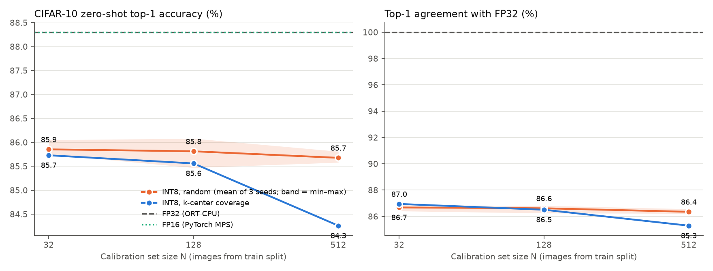
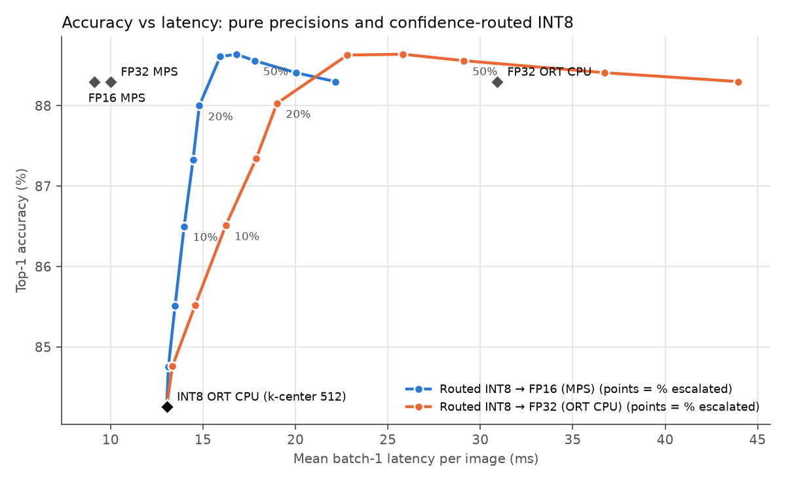

# Does coverage-based calibration selection help static INT8 PTQ of a VLM?

**Hypothesis.** For static INT8 post-training quantization, choosing calibration images to *cover*
the embedding space (greedy k-center) gives a better INT8 model than random selection, especially
at small calibration budgets N.

**Answer on this setup: no.** K-center was never better than random beyond seed noise, and at
N=512 it was clearly worse (84.26% vs 85.68% mean random; random seeds span 85.58–85.81%).
Routing low-confidence INT8 outputs to FP16 did work: escalating 20% of inputs recovers
88.0% accuracy (FP32 is 88.3%) at ~14.8 ms mean latency.

## Setup

| | |
|---|---|
| Model | OpenAI CLIP ViT-B/32 (`openai/clip-vit-base-patch32`), zero-shot |
| Task | CIFAR-10, frozen prompt `"a photo of a {}."`, full 10,000-image test set |
| Hardware | Apple M1 Pro (10-core CPU), 16 GB, macOS |
| INT8 | ONNX Runtime 1.31 static QDQ on CPU: per-channel symmetric INT8 weights, asymmetric UINT8 activations, MinMax calibration; MatMul/Gemm/Conv quantized, LayerNorm/Softmax/GELU kept FP32 |
| What's quantized | Image encoder only. Text embeddings and the cosine-similarity head stay FP32 |
| Baselines | FP32 on ORT CPU (the matched backend for INT8); FP32 and FP16 on PyTorch MPS. FP16 on CPU was not measured (no FP16 CPU path in this stack) |

**Calibration.** A fixed pool of 5,000 images is drawn (seed 0) from the CIFAR-10 *train* split;
the test split is used only for evaluation. Selection methods:

- **Random:** seeded permutation; seeds 0, 1, 2 to show seed variance.
- **K-center:** greedy farthest-point selection on L2-normalized FP32 CLIP image embeddings.
  It starts deterministically from the point nearest the pool mean.

Each method yields one ordering, and the N=32/128/512 sets are its prefixes. That gives 12 INT8
models: 4 orderings × 3 sizes.

**Measurement.**
- **Latency:** batch size 1, on a fixed set of 300 test images, with 30 untimed warm-up runs.
  Each image is timed in 3 passes and its per-image latency is the median. MPS runs are
  synchronized before stopping the clock.
- **Isolation:** every model is benchmarked in its own process.
- **Memory:** process peak RSS (`ru_maxrss`). For MPS this includes torch and does not fully
  capture GPU allocations.

## Results



| Variant | Backend | Top-1 % | Agree w/ FP32 % | Emb. cosine | p50 ms | p99 ms | Peak RSS MB | File MB |
|---|---|---|---|---|---|---|---|---|
| FP32 | ORT CPU | 88.30 | 100.00 | 1.000 | 30.9 | 31.4 | 811 | 335 |
| FP32 | PyTorch MPS | 88.30 | 100.00 | 1.000 | 10.0 | 10.7 | 773 | – |
| FP16 | PyTorch MPS | 88.30 | 99.92 | 1.000 | 9.0 | 9.7 | 1030 | – |
| INT8 k-center N=32 | ORT CPU | 85.73 | 86.95 | 0.818 | 13.1 | 13.5 | 634 | 85 |
| INT8 k-center N=128 | ORT CPU | 85.56 | 86.51 | 0.813 | 13.1 | 13.5 | 630 | 85 |
| INT8 k-center N=512 | ORT CPU | 84.26 | 85.30 | 0.812 | 13.0 | 13.3 | 646 | 85 |
| INT8 random N=32 (3 seeds) | ORT CPU | 85.85 (85.75–86.05) | 86.68 | 0.816 | 13.1 | 13.4 | ~650 | 85 |
| INT8 random N=128 (3 seeds) | ORT CPU | 85.81 (85.47–86.08) | 86.62 | 0.816 | 13.0 | 13.3 | ~640 | 85 |
| INT8 random N=512 (3 seeds) | ORT CPU | 85.68 (85.58–85.81) | 86.35 | 0.815 | 13.1 | 13.5 | ~640 | 85 |

Per-seed rows and raw numbers are in [results/results.md](results/results.md) and
[results/results.csv](results/results.csv).

**Reading it.**
- **Same-backend speed:** on ORT CPU, INT8 is 2.4× faster than FP32, has a 4× smaller file and
  uses ~170 MB less peak RSS. It costs about 2.5 points of top-1 accuracy.
- **Calibration size:** N barely matters for random selection (all means within 0.2 pt).
- **K-center fails at N=512:** k-center achieves its objective (coverage radius 0.54 vs ~0.65
  for random) but quantizes worse. One plausible explanation is that farthest-point sampling
  deliberately picks outlier images. With MinMax calibration, outliers widen activation ranges,
  which coarsens the quantization step for typical inputs. K-center also skews by class: 8 of
  10 classes at N=32, airplane- and truck-heavy at every N.
- **Practical takeaway:** for MinMax PTQ, coverage of the embedding space is the wrong target;
  range-representative (typical) samples matter more. Untested follow-ups: k-center combined with
  percentile or entropy calibration, or class-balanced and density-weighted selection.

## X-factor: confidence routing

Routing runs INT8 first. If the INT8 top-1/top-2 softmax margin is below a threshold, the image is
re-run at higher precision. The INT8 model is fixed in advance (k-center N=512), not chosen by
test accuracy.



| Escalated | Top-1 % → FP16 (MPS) | Mean ms | p99 ms | Top-1 % → FP32 (ORT CPU) | Mean ms |
|---|---|---|---|---|---|
| 0% | 84.26 | 13.0 | 13.3 | 84.26 | 13.0 |
| 10% | 86.50 | 14.0 | 22.7 | 86.51 | 16.2 |
| 20% | 88.00 | 14.8 | 22.7 | 88.03 | 19.0 |
| 30% | 88.61 | 15.9 | 22.7 | 88.63 | 22.8 |
| 100% | 88.30 | 22.1 | 22.8 | 88.30 | 43.9 |

- **AUROC for detecting INT8 ≠ FP32 top-1** (1,470 of 10,000 test images disagree): the margin
  score reaches **0.879**. Distance to the nearest calibration embedding reaches only 0.604, a
  weak signal.
- **Latency method:** routed latencies are composed from measured per-image batch-1 latencies of
  each model on the same images.
- **End-to-end check:** a real routed run at the 10% threshold (`python -m ptq.demo --bench`,
  [results/routing_e2e.json](results/routing_e2e.json)) measured 14.9 ms mean / 33.9 ms p99,
  against 14.0 / 22.7 composed.
  - The gap is likely MPS wake-up cost when GPU calls are sparse.
  - The composed p99 is therefore optimistic.
- **Same-device caveat:** INT8 runs on the CPU and FP16 on the GPU, so the FP16 route is not a
  same-device comparison. The FP32 ORT CPU route is. On this laptop, pure FP16 on MPS (9.0 ms,
  88.3%) dominates every CPU option. INT8/routing is the relevant choice only for CPU-only
  deployment.
- **Escalation above 100%-FP16 accuracy:** escalating 30–40% scores slightly higher than pure
  FP32/FP16 (88.6% vs 88.3%). This is within noise and should not be read as a real gain.

## Run it

```bash
python3 -m venv .venv && .venv/bin/pip install -r requirements.txt
.venv/bin/python -m ptq.run_all            # ~35 min on M1 Pro; every stage caches to artifacts/
.venv/bin/python -m ptq.run_all --report   # regenerate tables/plots from cache (seconds)
.venv/bin/python -m ptq.demo --cifar-test 0 1 2 5      # router demo on test images
.venv/bin/python -m ptq.demo path/to/photo.jpg          # or on your own image
.venv/bin/python -m ptq.demo --bench                    # real end-to-end routed timing
```

CIFAR-10 is loaded from the Hugging Face parquet mirror `uoft-cs/cifar10`, which uses the same
images, order and labels as the original release.

## Code

| File | Role |
|---|---|
| `ptq/common.py` | seeds, CLIP loading, frozen prompt, text embeddings, CIFAR-10 |
| `ptq/data_cache.py` | train-only calibration pool; cached resized uint8 images |
| `ptq/select.py` | random and k-center selection; coverage stats |
| `ptq/quantize.py` | ONNX export and ORT static INT8 |
| `ptq/build.py` | builds the 12 INT8 models |
| `ptq/evaluate.py` / `ptq/bench.py` | full-test-set metrics; isolated batch-1 latency/memory worker |
| `ptq/report.py` / `ptq/routing.py` | tables, plots, routing sweep, AUROC |
| `ptq/demo.py` | router demo |

**Standard tools vs this repo's code.** Model loading (Transformers), ONNX export, ORT quantization,
matplotlib and scikit-learn are standard tools. The calibration pool, k-center selection, eval and
timing harness, routing sweep and aggregation are implemented in this repo.

## Limitations

- **Scope:** one model, one dataset, one frozen prompt.
- **Calibration method:** MinMax only. The conclusion may differ under percentile or entropy
  calibration, which are less outlier-sensitive.
- **Single run per selection:** k-center is deterministic and random has 3 seeds. Differences
  under ~0.3 pt are within seed spread.
- **Latency is wall clock** on a laptop with other processes running. p99 over 300 images is
  noisy.
- **Peak RSS is process-level** and includes the Python runtime.
- **ORT pitfall:** in ORT 1.31, the quantization option `CalibMaxIntermediateOutputs` silently
  drops calibration batches (the collector clears buffered batches without merging them), so it is
  deliberately left unset.
- **Not done:** influence-based selection (deferred per plan) and a notebook upload widget. The
  demo is a CLI instead.
